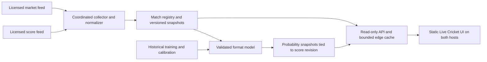

# Live Cricket: expansion plan and 3D exploration

Original plan: 23 October 2026 (America/Los_Angeles). Product baseline: `357bcd1`.

**Status update, 24 October 2026:** the owner subsequently authorized implementation and requested free sources. This document preserves the original planning proposal and its review history. Current delivered scope, source limitations and verification are recorded in the [implementation notes](../live-cricket-implementation.md). Other sports remain [future planned work](live-sports-roadmap.md).

## Confirmed intent

Create a separate Live Cricket section before returning to the earlier what-if/history roadmap. It should help a reader discover current cricket around the world, open a match, read its scorecard and follow both **Playoff Pulse model win probabilities** and **external bookmaker odds**. The owner explicitly chose both kinds of odds and confirmed that implementation is a later stage.

The research, wireframe and proposed work below are planning artifacts. The later implementation authorization does not approve purchases, new accounts or infrastructure deployment.

## Product recommendation

Keep **Season Odds** and **Live Cricket** as distinct primary destinations. A match center should answer, in order: what is happening, what the score is, what changed, what the model estimates, and what bookmakers quote. The score remains the first screen on a phone. Optional spatial explanation comes after the useful match information.

“Worldwide” is the discovery goal, not a claim of universal coverage. A provider can list a match without supplying its complete scorecard, delivery log or a betting market. Maintain a visible coverage register and field-level availability. Never infer that no cricket is being played because a feed returns no matches. Men’s, women’s, international, domestic and associate competitions need explicit coverage checks; amateur and unscored games may have no usable feed at all.

## What exists and what must be new

The current product is a static season-forecast site, updated by two scheduled data runs per day. Its CricketData adapter reads series/fixtures/points, while completed seasons use Cricsheet. The published frontend payload does not contain a live innings state, batter/bowler scorecard, ordered delivery stream, in-play probability output or bookmaker quotes. The cricket qualification solver is not a live win-probability model.

The source inventory contains 26 configured cricket seasons; the inspected published index exposes 17, all complete. Neither count measures current worldwide match coverage. In particular, `FixtureImpact.teamAWinProbability` means a selected team's **season qualification probability conditional on that fixture winner**. Its name must not lead to reuse as a match-win estimate.

Reuse Night Signal tokens, accessible tables, safe percentage formatting, source notices, theme persistence, route/base helpers, lazy page families and loading/recovery components. Keep existing league pages and their models separate from the new live-match domain.

Source references and capability gaps: [repository feasibility audit](../explorations/live-cricket/source-feasibility.md). Provider claims and commercial unknowns: [provider research](../explorations/live-cricket/provider-research.md).

## Proposed information architecture

| Destination | Main content | Important behavior |
| --- | --- | --- |
| Live Cricket lobby | Live, upcoming and recent matches; format, competition and team search | Show covered competitions, feed health and freshness; preserve filters on Back |
| Match summary | Score, innings, target, match phase, venue, toss/lineups when supplied | Preserve source status such as rain, innings break or stumps; never derive “live” only from start time |
| Scorecard | Batting, bowling, extras, partnerships and fall of wickets where available | Real tables; innings selector; contained phone scrolling; missing data is unavailable, not zero |
| Ball by ball | Delivery log, over summaries and corrections | Stable reading position, new-delivery control, ordered revisions and source times |
| Model win chance | Format-qualified model output, assumptions, timestamp and 2D history | Recompute only from an accepted score revision; unsupported states suppress the estimate |
| Bookmaker odds | Named bookmaker, market, selections, decimal prices, timestamps and availability | Independent freshness; distinguish open, suspended, closed, stale and missing markets |
| Optional field guide | Flat schematic, with a user-requested 3D view | Same information in text/2D; illustrative geometry clearly labelled; no implied tracking |

Provisional static-compatible routes: `/cricket/` for the lobby and `/cricket/?match=<public-match-id>` for a selected match. Both use the existing deployment base, so the mirror retains `/ipl_top4_analysis/`. A fixed entry document avoids requiring a generated file for every newly discovered match. Stable per-match canonical HTML can follow once discovery/archive publishing is designed. Exact route names remain a design decision, not an implemented contract.

The header should offer Season Odds and Live Cricket without adding a giant score ticker to every existing page. In the season section, change ambiguous season-status wording from “Live” to “In season” when the live-match section launches. Keep the league picker scoped to season forecasts; the match lobby gets its own search.

### Match states

Design scheduled, toss pending, in progress, innings break, rain/delay, suspended, stumps, completed, tie, super over, abandoned/cancelled, partial coverage, source error and stale-data states. “Today” must respect the reader’s time zone, while an active multi-day Test remains discoverable even when it began several days earlier. A temporary feed outage must not mark an ongoing match finished or erase it from the list.

## Model probabilities and bookmaker prices are different products

| Model win probability | Bookmaker price |
| --- | --- |
| Our statistical estimate for defined outcomes | A supplier’s quoted price from a named bookmaker |
| Percentage; never falsely round a sampled estimate to 100% | Decimal price by default, with its market and settlement definition |
| Includes model version, conditions and parent score revision | Includes bookmaker, market, selection, quote timestamp and market state |
| Requires training, calibration and format-specific validation | Requires licensed data access, event matching and allowed redistribution |

Keep the displays separate. A reciprocal decimal price is an implied market quantity with margin/settlement assumptions, not our model’s estimate. Do not create a single probability bar by mixing bookmaker prices and model outputs. If comparison is added, compare only matching outcome definitions and complete quotes from a consistent market; defer “value bet” recommendations.

Join score and market events conservatively using a persistent ID map plus competition, format, gender/category, teams and start time. Team-name similarity alone is insufficient. Postponements and repeated fixtures must not attach quotes to the wrong game. Ambiguous joins produce an unavailable market panel until resolved.

### New in-play model work

Start research with T20, including both men’s and women’s data, while keeping scorecards available for every verified format. T20, ODI, Tests and The Hundred must have explicit model support flags; T10 and other formats need their own validation. Unsupported formats still get score data rather than invented 50/50 forecasts.

Train offline on historical delivery states, with whole matches/time periods held out to avoid ball-level leakage. Evaluate Brier score, log loss and calibration against declared simple baselines, sliced by format, innings phase and competition/data support. Publish the model’s conditioning: for example, whether the prediction assumes a completed match with a winner, rather than silently treating rain/no result as impossible. Test-match draws, super-over rules, ties, revised targets and incomplete DLS state require explicit handling. Missing required state suppresses inference.

A probability history starts when actual timestamped model snapshots are recorded. Do not reconstruct a convincing-looking live history from the final outcome or one current snapshot. Score corrections invalidate or recompute affected model snapshots without silently rewriting the audit trail.

## Data and hosting approaches

| Approach | What it offers | Constraint | Disposition |
| --- | --- | --- | --- |
| A. Keep the current static publishing pipeline | Periodic score snapshots; smallest infrastructure change | Rebuild/deploy scheduling is unsuitable for ball-level freshness; keys cannot be put in browser code | Fallback if static-only remains absolute; label as snapshots, not live |
| B. Static frontend plus a small shared data service | Server-side provider keys, normalized snapshots, coalesced refreshes, independent model and market feeds | Changes the previous static-only constraint; provider access, budget and backend approval are still open | Recommended direction for the stated live goal; not yet approved |
| C. Licensed push feeds and richer spatial data | Lower-latency updates and potentially factual spatial views | Contract, coverage, tracking rights, operational and model complexity | Later option, not a prerequisite for the useful match center |

GitHub documents a five-minute minimum for scheduled workflows and possible scheduling delays/dropped jobs; increasing the current cron frequency does not create a reliable live feed. [GitHub scheduling documentation](https://docs.github.com/en/actions/reference/workflows-and-actions/events-that-trigger-workflows#schedule).

For B, a Cloudflare Worker/API facade with one coordinated collector/state owner is a plausible fit alongside the existing static hosts. The final choice of coordination/storage needs an engineering review. Edge caching alone must not be mistaken for a global provider-call lock: Cloudflare’s Cache API is local to a data center. [Cache API documentation](https://developers.cloudflare.com/workers/runtime-apis/cache/). A single Durable Object can coordinate shared work, but alarm delivery is not a hard real-time guarantee. [Durable Object storage/alarm documentation](https://developers.cloudflare.com/durable-objects/api/sqlite-storage-api/).

Both hosts consume the same public normalized service; do not run separate collectors per viewer or mirror. Keep the API key in server-side secrets, never a Vite environment variable, checked-in payload, public URL or client bundle. Restrict upstream hosts and API parameters, validate IDs, limit response sizes, and bound refresh concurrency, retries and rate usage. The public API is read-only; it exposes normalized permitted data, not provider credentials or an arbitrary upstream proxy.

### Freshness and correction contract

- Record provider observation/event time separately from collector fetch time, snapshot revision and model computation time. A successful re-fetch of an unchanged old payload must not make old data appear fresh. If provider time is unavailable, say “checked” rather than implying a new delivery.
- Proposed collection targets are 15–30 seconds for supported active score state and 30–60 seconds for market quotes, adjusted to purchased entitlements and source cadence. These are application goals, not provider SLAs. Discovery and inactive matches refresh less often.
- Use independent freshness states for score, commentary, model and market. Mark stale data visibly; hide suspended/stale market prices from any current comparison, and suppress a model if its parent score state no longer matches.
- Persist the last known good snapshot, apply provider revisions idempotently, and reject or reconcile out-of-order updates. Do not increment scores speculatively. Delivery corrections and changed targets are expected states.
- Browser polling runs only while the relevant view is visible, with jitter, conditional requests and backoff. Pause hidden tabs, recover on focus and preserve selected innings/filter/reading position. Avoid per-ball screen-reader announcements that interrupt reading.
- Give the reader a visible **Pause updates / Resume updates** control for foreground scores, scorecards, commentary, probabilities and quotes. Pausing freezes the displayed snapshot; show “Updates paused” and its actual observation time, with stale/paused prices excluded from current comparisons. Shared collection can continue. Resuming applies the newest accepted revision in place without resetting innings, filters, focus or reading position; offer a separate jump-to-latest control for commentary. The control is keyboard accessible and its state is announced without repeating the full scorecard.
- Prototype the exact cache keys and expiry behavior before adopting a cache product; do not assume a regional cache or eventually consistent store prevents a worldwide request stampede.

### Data contract to agree before coding

Separate match registry, coverage/capabilities, current score state, innings/players, delivery revisions, model snapshots and market quotes. Each carries provenance, observation time and schema/version identifiers. Use integer legal-ball counts with a format-specific display; cricket notation such as `17.5` is not a decimal fraction. Preserve wide/no-ball deliveries without incorrectly advancing the legal-ball count. Store super overs and multi-day innings as separate phases, and keep provider IDs alongside public match IDs.

## Call budget and cost planning

The commercial shortlist is **Sportmonks for scores/cards/deliveries plus The Odds API for bookmaker prices**, subject to verified coverage and rights. Public observations below were checked on 23 October 2026; they are neither quotes nor approved purchases.

| Candidate | Public price / limit observation | Selection condition |
| --- | --- | --- |
| Sportmonks | Dedicated cricket page: World €75/month; Enterprise from €129; excluding VAT; 2,000 calls/hour per endpoint | Verify current season/feature entitlement, measured delay and both domains. Its product page shows different league counts/Enterprise pricing, so obtain a current quote. [Pricing](https://www.sportmonks.com/cricket-api/plans-pricing/), [coverage](https://www.sportmonks.com/cricket-api/coverage/) |
| The Odds API | USD $30/month for 20,000 credits or $59 for 100,000; cricket mainly match-winner prices | Confirm active competitions, bookmakers/regions and settlement scope. Published featured-market cadence is 40 seconds in play, distinct from a delivery SLA. [Plans](https://the-odds-api.com/), [cricket](https://the-odds-api.com/sports/cricket-odds.html), [cadence](https://the-odds-api.com/sports-odds-data/update-intervals.html) |
| CricketData | Free 100 hits/day; paid volume tiers from $5.99/month | Existing integration makes comparison useful, but pricing says a few minutes delayed while terms say 30 seconds with a registered key. Resolve this before promising live freshness. [Pricing](https://cricketdata.org/pricing/), [terms](https://cricketdata.org/terms-of-use/) |
| Sportradar | Production cricket price, quota and SLA require a contract | Consider specified official ICC/ECB/CPL coverage; per-event coverage levels still vary. [Overview](https://developer.sportradar.com/cricket/reference/cricket-overview) |

Sportmonks pricing is per domain; the Cloudflare site and GitHub mirror need explicit treatment. The Odds API permits customer-facing display and derived/ML use, while prohibiting a standalone raw feed or downloadable data product. Confirm ordinary UI transport, caching, retention and both properties before adopting the existing public-Git/archive pattern for licensed quotes. Do not publish bulk provider payloads or quote archives by default. [Sportmonks terms](https://www.sportmonks.com/terms-of-service/), [The Odds API terms](https://the-odds-api.com/terms-and-conditions.html).

Estimate provider requests and provider-specific credits separately from visitor/API traffic. General formula: discovery requests plus the sum of active seconds divided by poll interval, multiplied by requests/credits per refresh. Pagination and retries consume budget too.

An illustrative capacity calculation—not an observed workload—is 20 matches × 8 active hours × one detail fetch every 30 seconds = **19,200 score-detail requests/day** before discovery, markets or retries. A bulk scoreboard can reduce list calls; full scorecards/deliveries may still be separate charged calls. The estimate must be recalculated from a sample week and the chosen endpoint contract rather than treated as a required subscription tier.

For The Odds API, the documented live/upcoming odds quota depends on requested markets and regions, rather than just HTTP request count. One league polled every 60 seconds for eight hours, with one market and one region, is 480 credits; ten such league feeds are 4,800 credits/day if data is returned. This is a nominal formula, not a claim that every cricket league or live market is supplied. [Quota documentation](https://the-odds-api.com/liveapi/guides/v4/#usage-quota-costs).

At the provider's advertised 40-second featured-market cadence, one such feed costs 720 credits per eight-hour day, or 21,600 over 30 days. Eight simultaneous feeds cost 172,800 before extra regions/markets. Thus the $30 tier is not an assumed fit, and upstream cadence does not establish ground-to-screen freshness.

Provider/pricing comparison and verification dates are maintained in [provider research](../explorations/live-cricket/provider-research.md). Existing secret metadata does not establish subscription entitlements or redistribution permission. Do not buy a plan or add a new key during this stage. Select an acceptable provider/coverage/rights/budget combination before implementation.

## 3D: where it adds value

Keep standings, odds bars, scorecards, distributions and price tables in 2D. Their job is accurate comparison. The useful 3D opportunity is a spatial view a reader deliberately opens, with a full flat/text equivalent.

| Surface | Recommendation | Required data / boundary |
| --- | --- | --- |
| New cricket match center | Optional field/pitch explainer first; factual shot/field view later | First view is an explicitly illustrative teaching diagram; actual field/shot maps need recorded coordinates |
| Delivery or wicket replay | Defer factual 3D replay | Timed trajectory/tracking data and rights are required; runs/wickets/fielders’ names do not establish ball flight |
| F1 page | Preserve 2D championship/gap boards; assess optional circuit context separately | Standings and calendar venue names do not establish a track centerline, car positions or telemetry |
| Landing/header | Restrained depth only if it helps orientation | Keep live score discovery and real race data prominent; no mandatory rotating stadium/download |
| League hub and generic sport pages | Keep dense searchable cards/tables and existing hierarchy | Goal/fixture data does not establish formations or player tracking |
| Share Kit | Keep reliable flat export by default | An optional rendered illustration must not alter odds, dates or historical graphics |

Cricsheet’s documented delivery schema supplies cricket events, not a spatial ball-tracking stream. Do not turn a six, boundary or named catcher into invented shot coordinates. [Cricsheet JSON format](https://cricsheet.org/format/json/).

The [interactive planning concept](../explorations/live-cricket/concept.html) uses actual historical published IPL results with a visible **Not live** label. Missing scorecards, probabilities and bookmaker quotes stay unavailable. Its field guide compares a flat SVG with optional CSS 3D tilt; it is a schematic, not a factual match replay or a full WebGL stadium.

For a future richer 3D component: load it only after an explicit action, render on demand, stop work when hidden, cap mobile rendering quality and supply camera presets/keyboard controls. A context-loss or unsupported-device fallback must retain all information in SVG/text. Honor reduced motion without an automatic orbit. Use DOM labels that stay readable outside the tilted scene. Measure incremental download/GPU/CPU cost on a phone; retain the existing initial-load budgets instead of shipping a 3D engine to every page.

Full current-site findings and prototype checks: [visual and 3D review](../explorations/live-cricket/visual-3d-review.md).

## Proposed implementation sequence

These are future tasks, not work authorized or performed in this planning stage.

| Step | Work unit | Exit evidence |
| --- | --- | --- |
| 1 | Agree coverage, score/market suppliers, public redisplay rights, allowed regions, refresh targets and monthly cap | Written capability matrix, entitlements and a sample-week call budget; approved architecture change |
| 2 | Provider adapters, match identity map, normalized fixtures and per-field capability states | Contract fixtures, corrected/delayed/outage cases, ambiguous event matches suppressed |
| 3 | Coordinated read-only data service, secrets, limits, snapshots and health | Provider-call coalescing, failover/staleness/revision tests; both hosts can read without exposing keys |
| 4 | Live Cricket lobby and match summary/scorecard/delivery views | Real verified feed data; no placeholder live values; filter/Back/deep-link behavior and accessible tables |
| 5 | Bookmaker view | Correct match joins, complete labelled markets, suspension/freshness handling and approved rights/regions |
| 6 | Offline T20 model research and shadow inference | Chronological match-level holdouts, declared baselines, calibration report and documented supported states |
| 7 | Model panel and timestamped probability history | Estimate matches score revision; supported conditions clear; gaps/corrections explicit; exact accessible values |
| 8 | Format expansion | ODI/Test/Hundred/other score support verified; probabilities enabled only after separate validation |
| 9 | Optional field guide / richer 3D prototype | Readable flat/text mode, explicit illustrative vs recorded data, reduced-motion and low-power fallbacks |
| 10 | Independent review, browser/performance gates and staged release | Both bases, phone/desktop/themes, model/data contracts, quota controls and explicit owner go-ahead |

Scorecards need not wait for every model, and a missing bookmaker market must not hide a covered match. The intended section includes both kinds of odds, but availability is honest per match and format throughout rollout.

## Acceptance criteria for the next stage

All criteria below are planned verification obligations, not current passes:

- An agreed competition inventory is discoverable with field-level scorecard/delivery/market/model coverage; coverage gaps are visible.
- Live scores are measured against source updates, with separate observed/fetched times; outages do not present stale data as fresh.
- Rain/DLS changes, wides/no balls, super overs, multi-day stumps, result corrections, long names, no matches and partial feeds have tested designs.
- Every model estimate is tied to its state/model version, supported format and conditioning; unsupported states are unavailable.
- Bookmaker quotes are tied to verified match/market IDs, their own timestamps and settlement scope. Suspended/stale/missing data is never shown as a current actionable price.
- No credential enters public JSON, URLs, browser code or repository history. Retry/call budgets and operator visibility are bounded.
- Phone layout has no page overflow at 320px, standalone targets are 44px, text is at least 12px, contrast is measured in both themes, and dynamic updates preserve keyboard/screen-reader use.
- Readers can pause/resume automatic foreground updates. The paused label and displayed observation time remain visible; resuming restores the latest accepted snapshot while preserving selection, focus and reading position. Paused quotes never appear current.
- Retain mobile lab targets of LCP under 2.5 seconds and CLS under 0.1; measure interaction latency with its field/lab distinction. Optional 3D is outside the initial route download and has an equivalent 2D/text fallback.
- Existing season pages, both hosting bases, query/hash links, theme persistence, model rules and original Share images continue working.

## Decisions still open before implementation

1. Coverage and entitlement: which exact competitions and fields can the selected score feed supply, and with what public display/caching rights?
2. Market supply: which bookmakers, regions, live markets and quote cadence are licensed, and how do their settlement rules align with our model targets?
3. Hosting: may the new section use a small server-side data service alongside the otherwise static application?
4. Budget: what monthly cap and peak quota/call limit are acceptable? No new subscription or key is approved by this document.
5. Model release: what independently reviewed calibration/coverage gates must be met before publishing live probabilities for each format?
6. 3D depth: is the small optional educational field guide sufficient for the first implementation, leaving factual replay dependent on a future spatial feed?

The next implementation stage should begin with provider/coverage validation and normalized contracts. It should not start by fabricating match data, exposing a key in the browser or treating the existing season solver as an in-play model.

## The assignment before implementation

Review the provider coverage checklist and identify five must-have competitions plus an acceptable monthly operating ceiling. Include the women's/domestic/associate coverage most important to the worldwide goal. This gives the next stage a concrete entitlement and cost check; it requires no purchase, provider contact or implementation now.

## What I noticed about how you think

- “Before expanding these features” establishes the new live-match section as the next priority; the earlier what-if/history roadmap remains deferred.
- “Both” makes the distinction between our model percentages and bookmaker prices a product requirement.
- “This is planning stage. Next is implementation” sets an explicit approval boundary. The prototype and this draft do not cross it.

<!-- gstack:office-hours:concerns:start -->
## Reviewer Concerns

Disposition: COMPLETED

Stop: PASS

No unresolved findings.
<!-- gstack:office-hours:concerns:end -->
