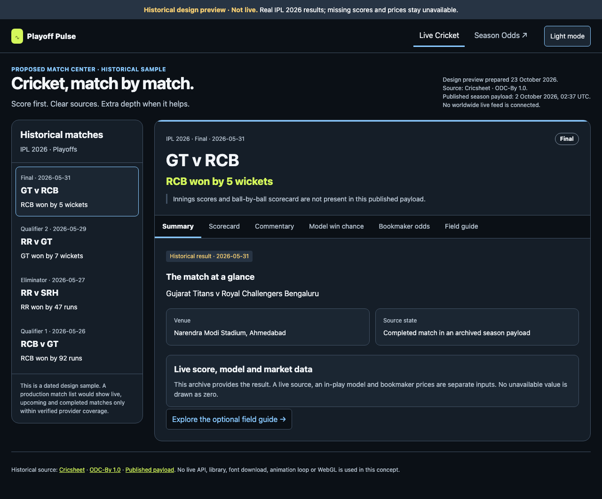

# Live Cricket: visual structure and 3D exploration

**Recommendation:** add **Live Cricket** beside **Season Odds**, with a score-first match center. Show **Model win chance** in percentages and **Bookmaker odds** in decimal prices as distinct views, each with its own source, timestamp and availability. Keep quantitative charts and tables in 2D. The useful near-term depth experiment is an optional field/pitch explainer, clearly illustrative and flat by default.

This is a design proposal, not an implementation approval or a claim of worldwide live coverage. No production code, data model, dependency or deployment was changed.

## What was inspected

On 23 October 2026, a real Chromium browser opened the primary [landing page](https://ipl-playoff-pulse.pages.dev/) at 1280px and the [IPL page](https://ipl-playoff-pulse.pages.dev/league/ipl-2026/) at 1280px and 375px. The loaded IPL view, rather than its initial loading state, was captured. Those light-theme viewport images are [landing](current-landing-light-1280.png), [cricket desktop](current-cricket-light-1280.png) and [cricket phone](current-cricket-light-375.png); [capture provenance](current-captures.json) records file times and hashes. No console errors were observed on those two pages. The broader six-family comparison uses the actual **20 October** [final production screenshots](../../screenshots/after/README.md), including newly re-read hub, football, F1 and Share captures. Those are saved evidence, not a fresh six-family browser audit.

Source inspection covered [DESIGN.md](../../../DESIGN.md), [route selection](../../../frontend/ipl-analyzer-frontend/src/Root.tsx), [shared navigation](../../../frontend/ipl-analyzer-frontend/src/components/SiteHeader.tsx), cricket/F1/generic sport schemas and the [Cricsheet adapter](../../../cricsheet.py). This applies the gstack design-review principles of explicit hierarchy, navigation, state coverage, subtraction and responsive accessibility. It does not run an approval interview or change the accepted design system.

## The current whole-site structure

Night Signal already gives data a useful hierarchy: ink/slate or pale neutral ground, solid data planes, selective glass, citron actions, sport accents and aligned numbers. Preserve that foundation. The current header has a league picker and theme control; it does not contain a match-live destination. “Live” currently means an active season, and the landing explicitly says “Season odds, rather than live scores.”

| Family | Existing hierarchy | Where depth earns value | Recommendation |
| --- | --- | --- | --- |
| Landing | Editorial headline → real title-race feature → cross-sport races → league directory → method. | A small optional explainer could demonstrate the new match product after its score preview. | Keep the headline and odds feature in 2D. A rotating stadium, trophy or decorative globe would compete with the first useful number and increase loading cost. Add a direct Live Cricket destination instead. |
| Hub | Search/filter controls → season state groups → dense league cards. | None in the main task of finding a league. | Preserve flat searchable destinations. Rename “All Live Races” to a season-odds heading and season “Live” badges to “In season” when actual match-live navigation is introduced. |
| Generic sports | Joined facts → standings/selected team → distributions, fixtures and conditional impact → method. | Spatial analysis only if a separate, real event-coordinate feed exists. | Keep probability lengths, positional distributions and percentage-point comparisons flat. Goals/results do not establish shot locations; perspective bars would obscure comparisons. |
| Cricket season | Final/active state → ladder → playoffs or team qualification analysis → method. | A labelled pitch/field guide can explain the game independently of season odds. | Preserve the ladder. Neither NRR nor qualification chance gains accuracy from a 3D chart. Link between the match center and its season page without mixing their probabilities. |
| Formula 1 | Driver/constructor boards → actual points gaps → calendar favourites/results → model. | A globe needs verified geographic locations; a circuit view needs track geometry; a replay needs timed telemetry. | Current `F1Event` has circuit, locality and country **names**, dates and favourites, but no latitude/longitude, track polyline or car coordinates. Keep calendar and gaps in 2D. Do not invent a factual globe or replay from names/standings. |
| Share Kit | Current post context → dated archive warning → downloadable historical artwork. | None in the primary copy/download task. | Keep the originals and clear archive dates. A rotating gallery or 3D cards would reduce text legibility and add interaction before download. |

## Data reality: what the site can and cannot draw

The inspected local published index contains **17 cricket seasons, all complete**; the fresh production menu also showed these as final. That does not establish that no cricket is being played worldwide. It establishes that this site currently exposes season archives rather than worldwide current match coverage.

The [cricket payload](../../../frontend/ipl-analyzer-frontend/public/data/ipl-2026.json) provides standings, fixture/result records, playoffs and season qualification analysis. [Its frontend schema](../../../frontend/ipl-analyzer-frontend/src/data/iplData.ts) has no live innings scorecard, delivery stream, bookmaker prices, match win-probability series, field coordinates, shot endpoints or trajectory samples. The Cricsheet adapter reads historical deliveries to aggregate innings runs, legal balls and wickets; its exported `Match` retains summaries rather than a spatial or live event stream. A fielder credited for a catch is not a fielder coordinate. A six is not a reconstructed ball flight. The official [Cricsheet delivery schema](https://cricsheet.org/format/json/#delivery-data) describes scoring and participants, not tracked spatial paths.

The proposed match model and market feed therefore need separate contracts. Existing equal-strength cricket **season** scenarios must not be relabelled as an in-play match predictor. Provider coverage, latency, rights and costs belong in the synthesized product plan; this review does not promise any provider's worldwide completeness.

## Proposed navigation and match hierarchy

Use two clear persistent destinations: **Season Odds** and **Live Cricket**. Within Live Cricket, use a match list and a stable match URL. Exact names remain undecided; the synthesized plan’s static-host-safe proposal is `/cricket/?match=<stable-id>`, with a real generated `/cricket/index.html` entry and the deployment base preserved (for example `/ipl_top4_analysis/cricket/?match=<stable-id>` on the GitHub mirror). Per-match canonical paths are conditional: they need a generated file for each address or routing support on both hosts. Arbitrary nested match paths must not rely on a Cloudflare fallback that the GitHub mirror does not provide. Keep the searchable season league picker in the season section; a separate match search should search teams, competition and venue rather than overload the league menu.

The match list should offer Live / Upcoming / Results, a named date/time zone, team/competition search and explicit format/men's/women's filters where the feed supports them. Group by competition. Show the actual available coverage; an empty provider response must not say “No matches worldwide.” Do not automatically reorder a card while a reader is selecting it. A selected match should link back to its competition's season odds when that identity mapping is verified.

**Desktop:** a compact match rail beside a broad match center. First show match state, innings scores, overs/balls, target/revised target and chase requirement; then current batters/bowler and update time. The match header stays outside the view tabs. Summary, Scorecard, Commentary, Model win chance, Bookmaker odds and optional Analysis/Field guide occupy the same content region rather than a dashboard of competing cards.

**Phone:** the selected score and state take the first screen; the match list has a clear return route. Use a compact score strip when reading a long scorecard or commentary, without covering focus or the first row. Tabs retain 44px targets in a contained horizontal rail, with keyboard navigation and a visible continuation. Do not shrink the labels to fit. The concept places the selected match before the historical list on phones; its extra provenance banner/intro is deliberately for review. A production match route should replace that intro with a short breadcrumb to bring the score higher.

## Two odds views, two meanings

| View | Display and provenance | Chart/table treatment |
| --- | --- | --- |
| **Model win chance** | Percentages; team/outcome labels; model/version; input score/delivery ID; computation time; source score time. Include draw/tie/no-result only when the model actually supports those outcomes. | A flat 0–100% timeline from persisted timestamped estimates, with exact values in a table. Use delivery sequence IDs, not decimal arithmetic on overs notation. Mark wickets, innings changes and data gaps; do not interpolate through missing coverage or reconstruct a history from today's one estimate. |
| **Bookmaker odds** | Decimal prices; named bookmaker; market and selection; quote time; open/suspended/closed state. The market may update at a different time from the score or model. | A readable price table first, filtered by bookmaker/market. Any price history uses a decimal-price axis and real quotes. Do not join it to the model probability line, call `1 / price` the model chance, or silently blend different bookmakers' margins/markets. |

If only scores are available, the match remains useful. A missing model or price is **Unavailable**, never 0%, 0.00 or an empty green bar. Keep the score and match state visible when either odds view is selected. Do not let a fresh network fetch timestamp disguise an old score, model run or price quote.

## Designed states

| Situation | Reader-facing treatment |
| --- | --- |
| First load | Static scorecard skeleton; “Loading match data”; no fake score or looping stadium. |
| Covered live match | Text state plus score-source update time and expected cadence. Announce a concise latest-score summary politely; do not announce the entire table on each ball. |
| Upcoming / toss / innings break | Explicit named state and known start time/target; unknown lineups or target remain unknown. |
| Rain / delay / stumps | Show the source's named reason/state. Freeze the displayed score; distinguish a stopped match from an overdue feed. Keep revised targets prominent when supplied. |
| Final / abandoned / no result | Preserve the official result text and source time. Match outcome and market settlement are separate states. |
| No covered matches live | “No live matches in our current coverage.” Offer upcoming/results and coverage details. |
| Missing scorecard/model/market | Explain which part is unavailable. Other independently available parts remain usable; no replacement by season odds. |
| Stale / offline / source failure | Retain the last known snapshot with its actual time, a visible stale/offline label and retry. Freshness thresholds must follow the provider contract, not a fabricated universal interval. |
| Suspended/closed market | Keep the state and last quote time visible; do not imply the last quoted price is currently available. |
| Corrections / reader reviewing history | Apply source corrections visibly. Preserve reading position and selection; use a “New balls” control rather than jumping the commentary. Provide update-frequency/pause controls while making paused display state explicit. |

Auto-updating content needs deliberate user control; the [W3C explanation of Pause, Stop, Hide](https://www.w3.org/WAI/WCAG22/Understanding/pause-stop-hide.html) covers updates displayed beside other content. This is a design requirement, not a claim that the future live interface already meets it.

## Where 3D is justified

| Option | Required evidence | Decision |
| --- | --- | --- |
| Factual field placement / wagon wheel | Actual per-delivery fielder locations or shot endpoints, coordinate frame/units, batter handedness and end/orientation, event IDs and source timestamps. | Potentially useful, but use a clear 2D map first. A tilted view is optional. No such data is in the current payload. |
| Pitch/trajectory replay | Time-indexed tracked coordinates and calibration, tracking confidence/coverage and explicit handling of missing samples. | Defer until a licensed verified feed exists. Do not infer bounce, swing, speed, height or an exact path from scoring commentary. |
| Conceptual pitch/field explainer | Schematic geometry; an unavoidable “Illustrative / not tracking” label; no attribution to the selected match. | Best bounded experiment now. Use a flat SVG with an optional user-triggered CSS 3D tilt and readable labels outside the transform. |
| Decorative 3D hero / depth charts | No factual benefit established. | Do not add to the main odds surfaces. It costs attention and rendering work and can make lengths/positions harder to compare. |

If tracked 3D is considered later, lazy-load its separate module only after explicit activation; keep the score, charts and 2D alternative usable first. Cap render resolution, stop rendering offscreen or when hidden, handle lost/unsupported WebGL contexts, and release resources when the view is closed. [MDN's WebGL guidance](https://developer.mozilla.org/en-US/docs/Web/API/WebGL_API/WebGL_best_practices) discusses context loss, per-pixel memory budgets, smaller back buffers and main-thread stalls. The proposed product should retain equivalent 2D/text information on devices where WebGL is unavailable. No continuous orbit, scroll parallax, autoplay replay or pointer tilt is necessary.

Follow Night Signal: existing fonts in production, 16px phone gutters, 4px spacing grid, 12px minimum text, 44×44px controls, labels beyond color, visible focus, and no page overflow at 320px. Reduced motion disables perspective transitions and defaults to a still flat explanation. Future performance acceptance should preserve the existing mobile LCP/CLS goals; this exploration did not run Lighthouse or establish a 3D performance budget by measurement.

## Clickable historical concept and actual captures

Open [concept.html](concept.html) locally. It contains the four actual IPL 2026 playoff records copied from the published payload, including the **31 May final: GT v RCB, RCB won by 5 wickets**, and credits Cricsheet / ODC-By 1.0. The payload generation time is **2 October 2026, 02:37 UTC**. The page says **Historical design preview · Not live**, does not fetch a live feed, and does not invent innings scores or prices. Match selection, theme control, keyboard tabs and the flat/tilted field comparison work. It is an information-design prototype with system fonts, not a finished production skin or a cricket simulator.

| Actual local capture | Light | Dark |
| --- | --- | --- |
| 375px phone | [Summary](concept-light-375.png) | [Summary](concept-dark-375.png) |
| 1280px desktop | [Summary](concept-light-1280.png) | [Summary](concept-dark-1280.png) |

Additional states: [model unavailable](concept-model-unavailable-1280.png), [bookmaker prices unavailable](concept-bookmaker-unavailable-1280.png), [flat phone field guide](concept-field-flat-375.png), [optional tilted desktop field guide](concept-field-tilt-1280.png). These are actual browser renders of this local concept, not screenshots of a working live service.

## Verification and limits

[Prototype checks](prototype-checks.json) retain 12 local Chromium probes. Summary was rendered at 375/1280 in both themes. At 320px in both themes, the field guide remained contained; model/market unavailable states and keyboard scorecard navigation were also exercised. Across the recorded states: no page-wide overflow, no visible link/button below 44×44px, minimum computed visible HTML text 12px, one active panel, no external resource requests and no observed console errors. End/Home/arrow keys selected the expected tabs; Tab reached the active panel. With real emulated reduced motion, the field transform was `none`, transition duration `0s` and tilt disabled. A settled non-reduced-motion capture confirmed an actual 3D matrix for the optional tilt. Selecting the second result changed the header/result and left exactly one match selected.

SVG text requires a separate check: a `font-size` inside a 520-unit viewBox is not its final painted phone size. This concept already hides all duplicate SVG `<text>` nodes with `.field text { display: none; }`; the Bowler/Batter/Keeper labels are ordinary **14px HTML** in `.guide-keys`, outside the transformed field. Follow-up browser checks at **375px and 320px** confirmed every SVG text node had `display: none` and zero painted width, and all three legend labels remained 14px outside the transform, with no page overflow. The SVG title/description also retain the schematic meaning. No concept or screenshot was changed for this follow-up; the existing captures remain truthful.

This was not a full contrast audit, screen-reader evaluation, WebKit/device test, live-feed failure test or performance test. No production test suite was run. All source/coverage/model/market/spatial-feed decisions remain proposals for the synthesized plan. The next useful implementation decision is the verified score/event, model and market contracts; extra 3D should follow a demonstrated information need.
