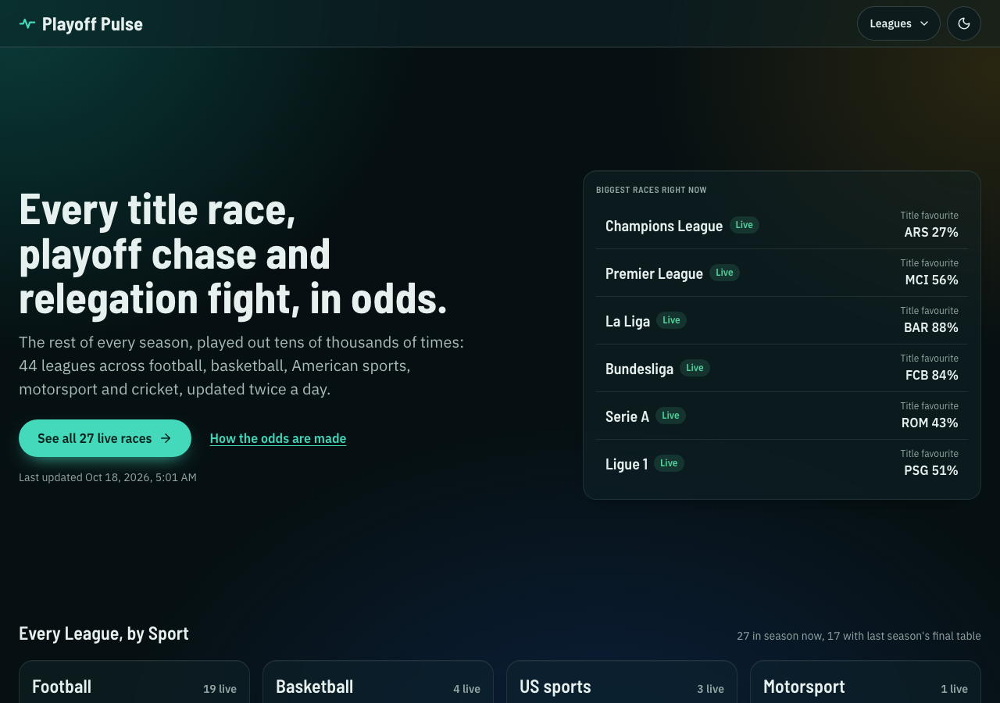
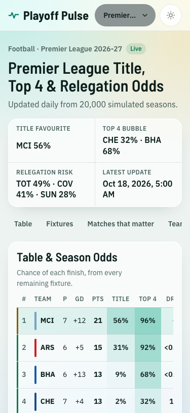
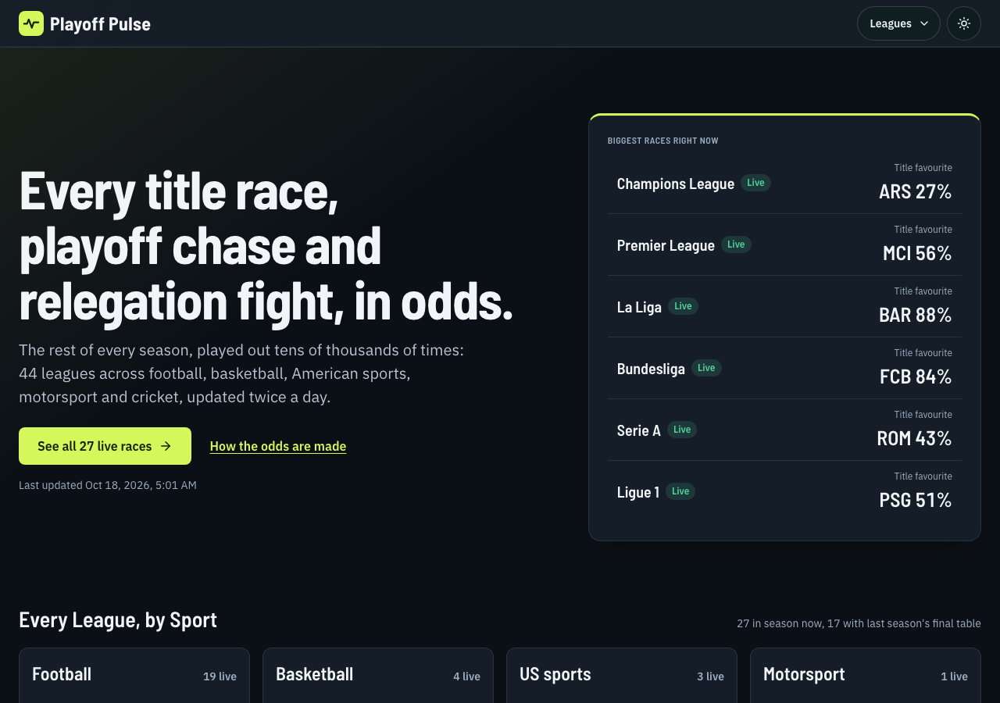
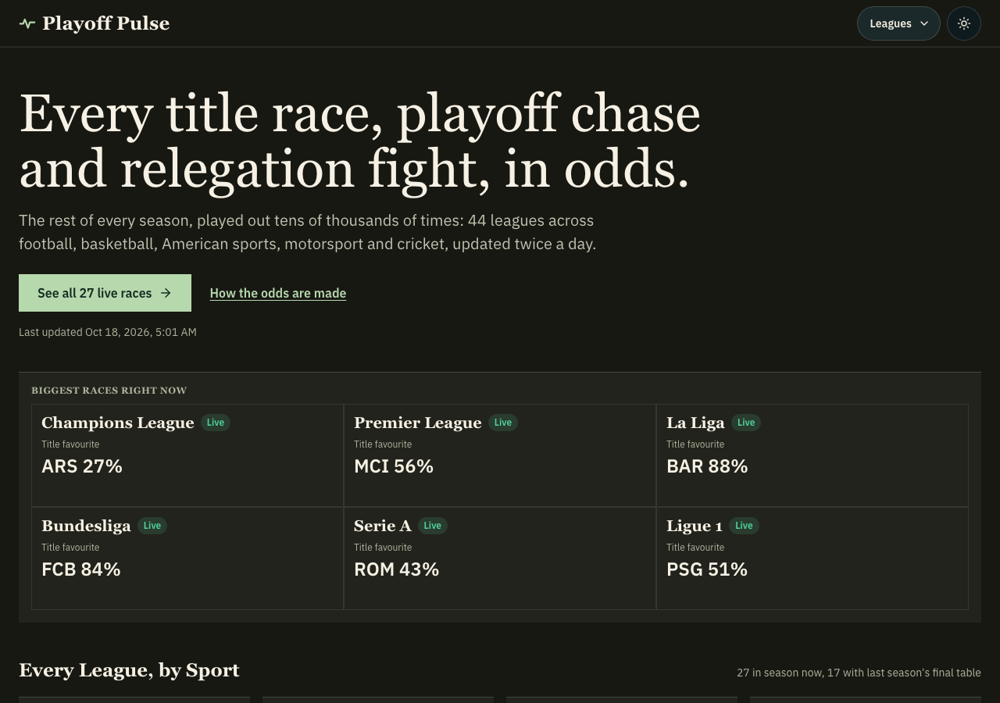
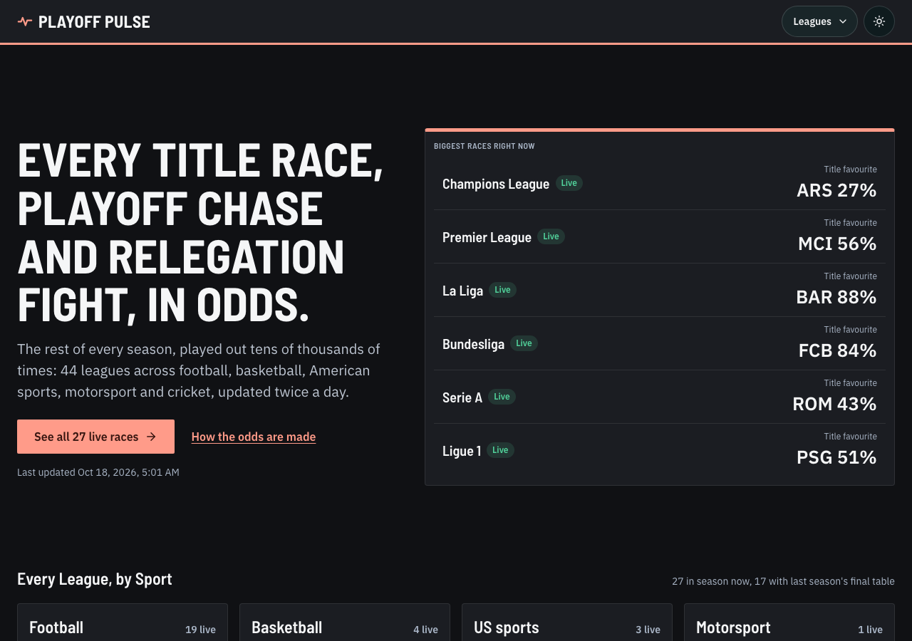
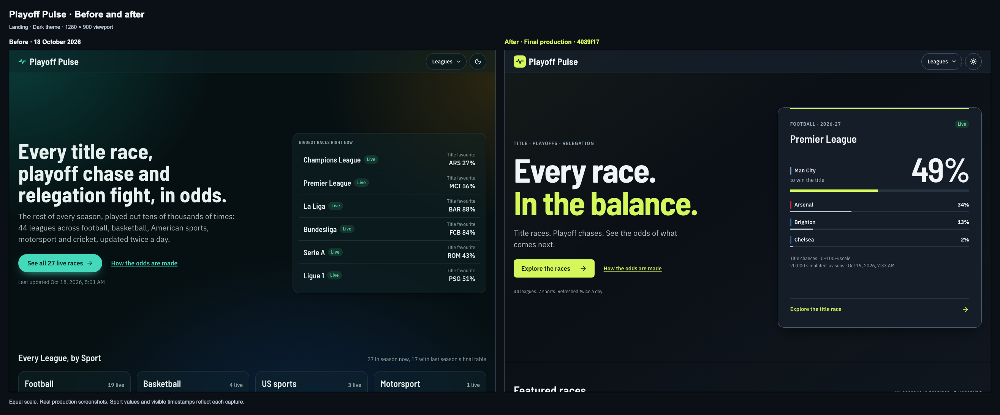
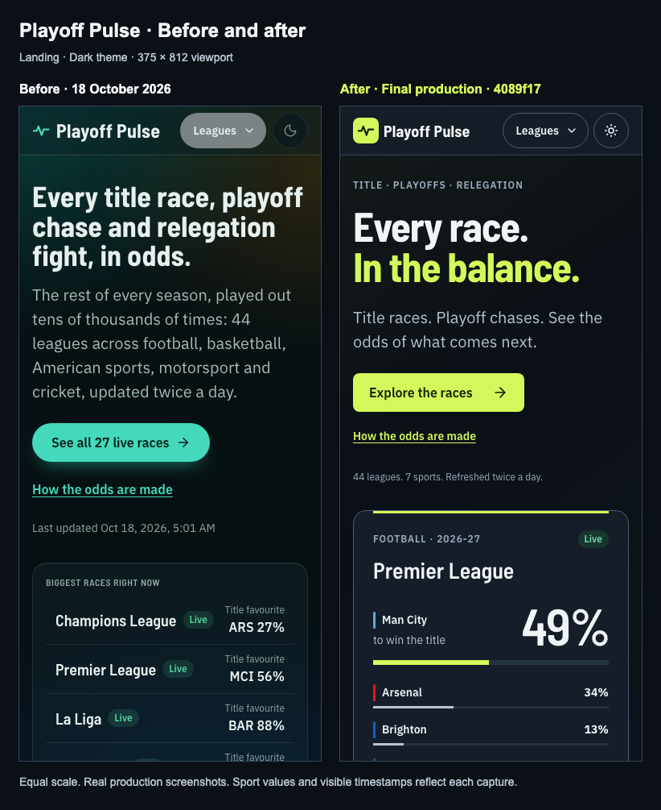

# Playoff Pulse site analysis and redesign

Audit and baseline: 18 October 2026. Release verification: 19 October Pacific / 20 October UTC, 2026. Production: [Cloudflare](https://ipl-playoff-pulse.pages.dev/) · [GitHub Pages mirror](https://rakeshnreddy.github.io/ipl_top4_analysis/).

**Night Signal is deployed on both hosts.** The redesign covers the landing page, league directory, shared sport pages, cricket, Formula 1 and Share Kit, plus 44 canonical league pages with data-backed social images. Models and probability values retain their existing rules. The release evidence below separates production checks, earlier local checks and remaining measurement limits.

## Multi-agent analysis

Three independent read-only workers covered nine lenses in parallel, followed by a separate completeness pass. Their full reports preserve source evidence and distinguish observations from unverified hypotheses:

1. [Visual/brand, information design and inspiration](audits/visual-data-inspiration.md).
2. [UX/navigation, accessibility and content](audits/ux-accessibility-content.md).
3. [Performance, SEO/shareability and frontend code](audits/performance-seo-code.md).
4. [Completeness critic](audits/completeness-critic.md).

The site already has substantive advantages: real league rules, semantic tables, careful season-odds rounding, self-hosted fonts, honest model notes and distinct final-season views. The problem is presentation hierarchy: almost every surface receives the same green glass treatment, six football headlines occupy the landing feature, and a long unfiltered menu stands between fans and their league. Preserve the statistical work and make its consequences more immediate.

## Rendered baseline

Captured all six page families at 375, 768 and 1280px, in both themes: 36 production screenshots plus per-page browser logs in `screenshots/before/`. First impression: competent and readable, but every region has similar weight. The landing headline and large empty hero space dominate; the six textual race rows are less distinctive than the product deserves. On league pages, compact titles and properly aligned odds already work well.

## Priorities and disposition

These are the original audit priorities. Their resolution targets shipped in PRs #78–85; the final checks and retained limits are recorded below.

| Priority | Finding | Resolution target |
| --- | --- | --- |
| P1 | Fixture segments clamp small outcomes to 6%; cricket tracks clamp even zero to 2%. Numbers and geometry disagree. | Exact tracks, external labels; no model changes. |
| P1 | Some 36/40px controls violate the owner's 44px requirement. | Shared control foundation, verify actual boxes. |
| P2 | Generic query-page metadata prevents league-specific social previews. | Static path-based HTML/content, data-backed social PNGs; retain query compatibility. |
| P2 | All page families load eagerly; full initial JS is 82.0 KiB gzip rather than only the 62.7 KiB shared chunk. | Lazy page-family imports and compare total initial transfer. |
| P2 | Uniform glass/green treatment has weak hierarchy and repeated mobile blur cost. | Night Signal, solid data planes, selective blur, sport identity. |
| P2 | Forty-four-entry menu and hub have no search. | Searchable picker with keyboard focus return; sport/search hub filters. |
| P2 | Position distributions have no visible scale and hide exact values behind hover. | Label scale and expose the values for touch/keyboard. |
| P2 | Landing copy claims every sport has strength ratings, labels pre-season as in progress, and calls priority-ordered features “biggest”. | Describe model differences, use honest active/featured language, spread sports. |
| P2 | Malformed team hashes can throw; fresh hydration hashes need browser checks; Share Kit back route goes to landing. | Shared safe hash handling and route-correct navigation. |
| P3 | Loading is a spinner; stale graphic context and sport-specific identity need polish. | Static skeletons, archive dates, F1 points-gap context and per-family refinements. |

## Direction comparison

Three genuinely different visual studies were rendered on real production screens/data: **Night Signal** (ink/citron/selective glass), **Season Ledger** (warm paper/editorial serif/open rules), and **Race Control** (coral/squared timing boards/condensed capitals). Each has 20 screenshots: five page families × two widths × two themes. See [direction specification](audits/visual-data-inspiration.md#three-distinct-visual-directions), the CSS in `design-directions/`, and the scores in [DESIGN.md](../DESIGN.md).

Night Signal wins on evening use and recognisable multi-sport character. The final direction borrows disciplined data rules from Ledger and controlled sport accents from Race Control. Typography stays self-hosted Barlow Semi Condensed + IBM Plex Sans; no new font family download.

## Baseline measurements

A mobile Lighthouse 13.5.0 run on the primary production landing returned **performance 98, accessibility 96, LCP 1.8s, CLS 0, TBT 0ms**. The exact settings/environment and audit failures are in [before.json](performance/before.json). This is lab evidence, not field Core Web Vitals or an INP measurement. Initial production JS: 75,862-byte entry + 202,794-byte preloaded runtime/shared module, 84,014 bytes combined local gzip (82.0 KiB). The comparison uses total initial JS, not only the largest chunk.

## Delivery and evidence

The foundation and each page family shipped in separate logical PRs, rebased onto refreshed main and merged sequentially after green checks. Each deployment was checked on the primary site before the next merge. The visual and performance production evidence below was captured at product revision `4089f17249c90f248dd5b18e442fb835976f7489`. This follow-up records that rollout and removes one redundant unsupported ARIA label from the cricket champion container; its visible heading and content are unchanged.

| Unit | PR | Merge | Successful deployment run | Cloudflare deployment |
| --- | --- | --- | --- | --- |
| Foundation | [#78](https://github.com/rakeshnreddy/ipl_top4_analysis/pull/78) | `671d300` | [39188729304](https://github.com/rakeshnreddy/ipl_top4_analysis/actions/runs/39188729304) | `6971af64` |
| Shared sport pages | [#79](https://github.com/rakeshnreddy/ipl_top4_analysis/pull/79) | `be9acc4` | [39225569146](https://github.com/rakeshnreddy/ipl_top4_analysis/actions/runs/39225569146) | `dababd54` |
| Landing | [#80](https://github.com/rakeshnreddy/ipl_top4_analysis/pull/80) | `654773a` | [39226739044](https://github.com/rakeshnreddy/ipl_top4_analysis/actions/runs/39226739044) | `a31d4903` |
| Cricket | [#81](https://github.com/rakeshnreddy/ipl_top4_analysis/pull/81) | `1e8b727` | [39227317027](https://github.com/rakeshnreddy/ipl_top4_analysis/actions/runs/39227317027) | `0e2f569a` |
| Hub | [#82](https://github.com/rakeshnreddy/ipl_top4_analysis/pull/82) | `1581bdb` | [39319992171](https://github.com/rakeshnreddy/ipl_top4_analysis/actions/runs/39319992171) | `95a83c37` |
| Formula 1 | [#83](https://github.com/rakeshnreddy/ipl_top4_analysis/pull/83) | `247f689` | [39320964904](https://github.com/rakeshnreddy/ipl_top4_analysis/actions/runs/39320964904) | `e306d157` |
| Share Kit | [#84](https://github.com/rakeshnreddy/ipl_top4_analysis/pull/84) | `8352f30` | [39321538208](https://github.com/rakeshnreddy/ipl_top4_analysis/actions/runs/39321538208) | `6413ac0a` |
| Static league sharing and request discovery | [#85](https://github.com/rakeshnreddy/ipl_top4_analysis/pull/85) | `4089f17` | [39365075241](https://github.com/rakeshnreddy/ipl_top4_analysis/actions/runs/39365075241) | `d669d3be` |

The final run's Cloudflare log explicitly reports “Deployment complete” at `2026-10-20T03:37:17Z`, with [deployment d669d3be](https://d669d3be.ipl-playoff-pulse.pages.dev/). The workflow's green conclusion alone was not used as Cloudflare proof. Full merge SHAs and per-release verification status are in [rollout-status.json](release/rollout-status.json).

### What changed

Ink, slate and citron give the site an identity suited to evening reading. Solid table planes preserve numerical contrast; glass is restricted to a few feature/header surfaces. The editorial landing pairs a shorter headline with real title probabilities and a cross-sport selection. Searchable league navigation and a filterable hub shorten the path to a competition.

Odds now retain their actual geometry: zero-width zero outcomes, no artificial 6% fixture minimum, a labelled distribution scale with keyboard/touch values, and conditional game impact expressed in percentage points. Cricket distinguishes final standings from an active race and explains sampled estimates and NRR. F1 uses separate driver/constructor timing boards with actual points gaps. Team selection, section hashes, theme persistence and both deployment bases remain supported.

Share Kit separates current post data from archived artwork, shows per-slide dates and returns to the correct league. Its 11 WebP gallery previews defer loading until needed; all original PNG downloads and prior manifest fields remain intact. The first preview is about 58 kB versus the original 182 kB PNG. Copy/export failures have visible recovery feedback.

All 44 canonical `/league/<id>/` documents contain league-specific metadata, JSON-LD, timestamps and a meaningful `<noscript>` standings snapshot; F1 includes both tables. They have 1200×630 data-backed social PNGs. The interactive application remains client-rendered: this is not React SSR or hydration. Legacy query links work, but retain generic initial social metadata on static hosting; use canonical paths when sharing. The sitemap has 46 entries. Root and league pages link a manifest and install icons; Share omits the install hint after a controlled performance comparison. There is no service worker or offline odds cache.

### Before and after

These boards place actual production captures at equal CSS scale. The final full-page capture is cropped to the baseline viewport height, with no redrawing of data. Visible dates differ because the site continued its scheduled updates during the rollout.

The [final screenshot index](screenshots/after/README.md) curates 24 primary-production captures: six families × 375/1280px × light/dark. The [independent final visual review](audits/final-visual-review.md) records the per-image verdicts. Baseline and direction renders above remain distinct from final production evidence.

### Verification

- **180/180 final production browser cases pass** across both hosts, canonical and retained query routes, Chromium and WebKit, both themes. Primary-site checks include 320, 375 and 1280px; the mirror includes 375 and 1280px. No page overflow, console/page/request/HTTP errors, sub-12px text or undersized standalone controls were found. Real section/team clicks retain the route/base; search, Escape focus return, theme persistence and canonical menu navigation/Back were exercised. Twenty Share cases decoded all 11 slides, 220 image decodes. See [aggregate and eight raw result links](release/final-browser-matrix.json).
- **90/90 production artifact cases pass**: every league's HTML and matching social PNG on both hosts, plus both manifests. Eight install/apple icons additionally return the expected PNG dimensions. Checks compare source standings, timestamps, notices and metadata against the published payloads. See [static-production.json](release/static-production.json).
- Final source checks: **303 Python tests, one skipped; 120 Vitest tests; lint; both Cloudflare and GitHub builds pass**. WPL/index regeneration was byte-identical. The final combined local gate had 144 browser cases, 16 no-JavaScript state/base/theme cases, 58 route guards, 24 root/Hub guards and seven request-reuse checks; see [static-final.json](release/static-final.json) and [independent static review](audits/static-independent-review.md).
- Independent reviewers confirmed and repaired the probability-track floors, histogram access, malformed/deep hashes, sticky inspector focus/scroll, Monte Carlo labels, Share archive dates/return links and selected-route preloads. Historical reports preserve findings at their original review stage; the final evidence supersedes their pending production gates. See [foundation](audits/foundation-review.md), [F1](audits/f1-independent-review.md), [Share](audits/share-independent-review.md) and [static integration](audits/static-independent-review.md).

Actual axe runs report zero violations. Automated results retain incomplete/manual-review flags rather than calling them complete WCAG certification. Rendered contrast evidence and its sampling limits are recorded in the [final accessibility review](audits/final-accessibility-review.md). Current production payloads supply the browser matrix; family unit tests and bounded synthetic cricket fixtures cover additional loading, empty, error, pre-season, active, playoff and final branches. This does not claim every possible league/state combination was injected into a production browser.

The final screenshot-background probe measured **272 text pairs**, including the translucent header, selected/hovered menu controls and shared page surfaces. All met their applicable AA threshold: minimum **5.089:1 light / 5.753:1 dark**. Four informative neutral-bar samples measured at least **4.863:1 / 5.259:1** against actual plot grid lines. [Selectors, sampled colors, coordinates and method](release/rendered-contrast.json) are retained. Eight compound header selectors without direct text were skipped; the sample does not certify every node, source-warning state, tiny bar, raster graphic or screen-reader behavior.

The final manual pass identified a redundant `aria-label` on cricket's generic champion container. This follow-up removes the unsupported attribute while preserving the visible champion/season text. Independent source review found no dependent selector or test. Fresh Python (303, one skipped), Vitest (120), lint and both builds pass; **24/24 affected cricket browser cases** pass on both local hosting bases, in Chromium/WebKit, at 320/375/1280px in both themes. The corresponding `aria-prohibited-attr` incomplete flag is absent after the repair. [Follow-up evidence](release/champion-aria-followup.json) distinguishes this local gate from the earlier production capture; the final merge/deployment still requires its own smoke check.

### Production performance

Lighthouse 13.5.0 ran on the primary production site after the other test browsers closed, using mobile 412×823 emulation, simulated 4G (150ms RTT, 1,638.4 kbps) and 4× CPU slowdown. All six families meet the measured LCP/CLS budgets in this sample. [Full settings, environment and warnings](performance/after.json) are retained.

| Page | Performance | Accessibility | LCP | CLS | TBT |
| --- | ---: | ---: | ---: | ---: | ---: |
| Landing | 99 | 100 | 1.93s | 0.00000 | 0ms |
| Hub | 98 | 100 | 1.73s | 0.00000 | 0ms |
| Football | 97 | 100 | 1.97s | 0.00000 | 7.5ms |
| Cricket | 97 | 100 | 1.89s | 0.00000 | 0ms |
| Formula 1 | 95 | 100 | 2.45s | 0.00057 | 0ms |
| Share Kit | 99 | 100 | 2.02s | 0.00000 | 6ms |

Landing LCP moved from 1.80s at baseline to 1.93s; this release does not claim a faster landing paint. Accessibility moved from 96 to 100, and CLS stayed zero. The before/after production runs use Lighthouse 13.5.0, host Chrome 155 and the same throttling settings, with separate network samples; the difference is descriptive rather than a controlled causal estimate. Intermediate local measurements used Chrome 151 and are not substituted for these production numbers. Share's report retains Lighthouse's redirect warning: Cloudflare normalizes `share.html` to `/share`, which loaded successfully and met the budget. Scores are lab snapshots, not field percentiles.

Initial asset JS on landing fell from **84,014 to 72,144 bytes local gzip**, a 14.1% reduction using the same asset-source gzip method. The final shared runtime/data chunk is 61,403 bytes (60.0 KiB), near the original 64,178-byte shared chunk. Across all six families, initial asset JS is 70,997–78,351 bytes; including inline scripts, the maximum is **78,566 bytes (76.7 KiB)**. The [bundle report](performance/bundle-after.json) lists actual loaded resources, observed transfers and inline scripts separately; gzip sums are not wire-transfer totals.

An independent 375×812 Event Timing probe at 4× CPU observed a maximum of **168ms** for theme toggle, 104ms for menu opening, 32ms for search and 40ms for team selection. [Raw interaction samples](performance/static-interaction-lab.json) include event counts and quantized durations. These are bounded lab samples, **not field p75 INP**. Field INP remains unmeasured; TBT and these samples do not certify the under-200ms real-user target. No analytics or third-party tracking was introduced to obtain it.

## Next steps retained from the owner

- Shareable, indexable league paths, metadata, social PNGs and JSON-LD are complete in this release.
- What-if outcomes in a worker or from the payload's conditional splits; no runtime server.
- Persist compact timestamped odds history before adding title-race timelines.
- Share Kit coverage beyond cricket.
- Cookieless analytics only after the owner enables Cloudflare Web Analytics in the dashboard.
- AFL and NRL before March 2027; rugby needs try counts absent from the current feed.
- Verify WBBL season discovery and summer cricket, current NBL/A-League finals assumptions, and the NWSL final venue per season.

No paid service, API key, DNS/dashboard change or publishing outside this site is part of this rollout.
